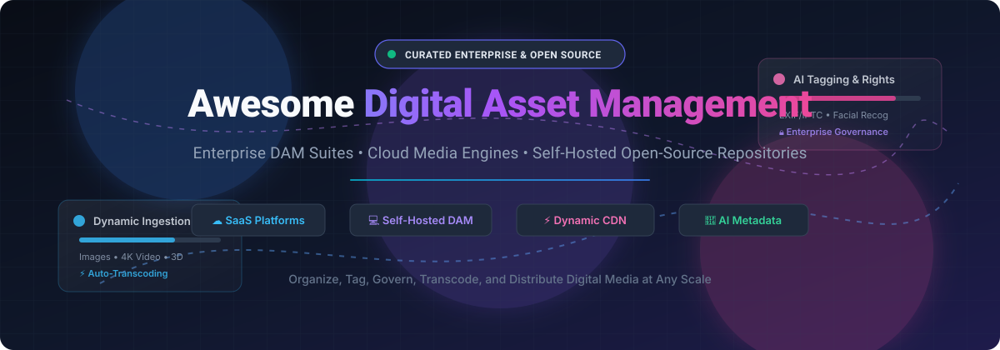

# 🗂️ Awesome Digital Asset Management (DAM)

  
  
  
  
  
  
  

**A curated directory of leading Digital Asset Management (DAM) software, enterprise SaaS platforms, media libraries, and self-hosted open-source DAM solutions.** 🚀

Digital Asset Management (DAM) software centralizes, tags, governs, searches, transforms, and distributes rich media assets—including high-resolution photography 📸, 4K/8K video 🎥, audio files 🎙️, 3D models 🧊, creative design packages 🎨, and marketing documents 📑.

---

## 📑 Table of Contents

- [📊 Sector Overview & Market Dynamics](#-sector-overview--market-dynamics)
- [☁️ SaaS / Hosted DAM Platforms](#️-saas--hosted-dam-platforms)
- [💻 Open-Source DAM & Media Management Projects](#-open-source-dam--media-management-projects)
- [🏗️ Architecture & Selection Guide](#️-architecture--selection-guide)
- [🤝 Support](#-support)
- [⭐ Star History](#-star-history)
- [💡 How to Contribute](#-how-to-contribute)
- [⚖️ Disclaimer & License](#️-disclaimer--license)

---

## 📊 Sector Overview & Market Dynamics

The global Digital Asset Management (DAM) market size is estimated between **$6.2 Billion and $7.5 Billion**, with projections expanding past **$15–$20 Billion** at a compound annual growth rate (CAGR) of 14% to 16% 📈.

The sector is **moderately fragmented**: while a dense ecosystem of specialized point solutions, vertical-specific SaaS products, and self-hosted open-source software thrives across SMEs and developer communities, enterprise-tier spend remains heavily anchored around consolidated market leaders and marketing cloud suites (e.g., Adobe, Smartsheet/Brandfolder, Cloudinary, Bynder) 🌐.

---

## ☁️ SaaS / Hosted DAM Platforms

The following table benchmarks notable commercial and cloud DAM platforms. Entries are sorted in descending order by **Company Size / Valuation / Scale** 🏢.

| Platform | Company Scale / Valuation / ARR | Starting Tier Price | Free Tier / Trial Limits | Key Focus & Capabilities |
| :--- | :--- | :--- | :--- | :--- |
| **[Adobe Experience Manager (AEM) Assets](https://business.adobe.com/products/experience-manager/assets.html)** | **~$24B+ Revenue** 🏛️ (Public: NASDAQ: ADBE; Multi-hundred billion Market Cap) | ~$25,000 – $40,000/year (Prime Tier entry baseline; Enterprise cloud implementations often $100,000+/year) | No self-serve free tier; Guided enterprise sandbox/proof-of-concept provided via Adobe enterprise sales engagement | Enterprise-scale DAM deeply integrated with Adobe Creative Cloud and Experience Cloud; AI content automation via Sensei/Firefly. |
| **[Brandfolder (Smartsheet)](https://brandfolder.com/)** | **$8.4B Valuation** 💼 ($1.1B+ ARR; Acquired by Blackstone & Vista Equity Partners) | ~$1,600/month (Entry-tier custom contract; billed annually starting around ~$19,000–$20,000/year) | No self-serve free tier; 14-day guided test sandbox available upon sales consultation | Marketer-friendly digital asset management with automated tagging, brand templating, CDN distribution, and asset analytics. |
| **[Cloudinary](https://cloudinary.com/)** | **$2.0B Valuation** 🦄 (~$100M ARR; Backed by Blackstone) | $99/month ($89/month billed annually for Plus Tier) | **Free Forever Plan**: 25 credits/month (~25 GB managed storage or 25 GB monthly net bandwidth or 25,000 image/video transformations), up to 3 users | Developer-first and marketing media engine with dynamic real-time image/video transformations, AI auto-tagging, and multi-CDN optimization. |
| **[Acquia DAM (formerly Widen)](https://www.acquia.com/products/acquia-dam)** | **~$1.0B – $2.5B Valuation** 🏙️ (~$200M+ Revenue; Vista Equity Partners portfolio) | ~$20,000 – $25,000/year (Entry enterprise tier based on storage and seat allocation) | Structured evaluation trial environment (14-day sandbox access configured through technical sales consultation) | Enterprise DAM and PIM combination for global brands; centralized governance, metadata modeling, and Drupal/DXP ecosystem integration. |
| **[Bynder](https://www.bynder.com/)** | **$100M+ ARR** 🎯 (Private equity-backed by Thomas H. Lee Partners) | ~$450 – $500/month (Baseline entry package; scaled enterprise tiers typically $15,000–$35,000+/year) | No self-serve free trial; Guided interactive product demo and sandbox environment upon sales qualification | Intuitive brand operations and creative workflow DAM; automated digital brand guidelines, creative templating, and portal sharing. |
| **[Frontify](https://www.frontify.com/)** | **~$60M ARR** 🎨 ($80M+ VC funding raised; backed by REVA Medical, High-Tech Gründerfonds) | ~$79 – $99/seat/month (Starter/Growth packages; Enterprise tiers custom-scoped) | **14-day free trial** with access to core digital asset management and interactive brand guideline workspaces | All-in-one brand management platform unifying DAM, living design guidelines, brand portals, and UI pattern libraries. |
| **[Canto](https://www.canto.com/)** | **~$40M – $52M Revenue** 📂 (Backed by JMI Equity) | ~$25,000/year (Baseline marketplace contract for core storage and designated power seats) | **7-day free trial** (available upon request via website verification) | Turnkey, user-friendly DAM designed for marketing teams, non-profits, and educational institutions with smart albums and portals. |
| **[MediaValet](https://www.mediavalet.com/)** | **~$80M Valuation** 🛡️ (~CA$16M ARR; Acquired by Symphony Technology Group / STG) | ~$5,000/year (Storage-based pricing model rather than aggressive per-seat user taxation) | No instant self-serve trial; Guided sandbox evaluation account coordinated post-technical demo | Cloud-native DAM built on Microsoft Azure infrastructure; enterprise security, unlimited user seats, and AI audio/video transcription. |
| **[ImageKit](https://imagekit.io/)** | **Bootstrapped** ⚡ (~$3.5M – $3.9M Revenue; Profitable global SaaS) | $49/month (Standard plan with 100 GB streaming bandwidth and 20 GB media library storage; additional custom scale tiers) | **Free Forever Plan**: 20 GB monthly CDN bandwidth, 3 GB media storage, 500 video processing units (VPUs), 650 AI extension units, unlimited requests | Lightweight, developer-friendly DAM with integrated global CDN delivery, URL-based image transformations, and storage adapters. |

---

## 💻 Open-Source DAM & Media Management Projects

Self-hosted and open-source solutions provide complete data sovereignty, zero per-seat licensing fees, and full infrastructure customization 🛠️. 

Sorted in descending order by **GitHub_Stars_Count** ⭐:

| Project | GitHub_Stars | License | Primary Stack | Core Description & Capabilities |
| :--- | :--- | :--- | :--- | :--- |
| **[Immich](https://github.com/immich-app/immich)** |  | AGPL-3.0 | TypeScript, Dart, Python | High-performance self-hosted backup and media asset management solution; features facial recognition, machine learning clip search, reverse geocoding, and mobile apps. |
| **[Paperless-ngx](https://github.com/paperless-ngx/paperless-ngx)** |  | GPL-3.0 | Python, Django, Angular | Document and media management system that indexes, OCRs, tags, and organizes PDFs, digital scans, and document assets with full-text search. |
| **[PhotoPrism](https://github.com/photoprism/photoprism)** |  | AGPL-3.0 | Go, Vue.js | AI-powered photo and visual asset management platform; automatic image categorization using Google TensorFlow, facial recognition, duplicate detection, and RAW conversion. |
| **[Ente](https://github.com/ente-io/ente)** |  | AGPL-3.0 | Flutter, Go, TypeScript | End-to-end encrypted, self-hostable photo and media asset management platform; client-side cryptographic privacy with web, desktop, and mobile sync. |
| **[UnoPim](https://github.com/unopim/unopim)** |  | OSL-3.0 | PHP, Laravel, Vue.js | Modern Product Information Management (PIM) and Digital Asset Management (DAM) platform built to organize, enrich, and scale millions of media assets and product catalogs. |
| **[LibrePhotos](https://github.com/librephotos/librephotos)** |  | MIT | Python, React | Open-source photo management and self-hosted visual asset service with semantic search, face recognition, map geolocation, and album organization. |
| **[Pimcore](https://github.com/pimcore/pimcore)** |  | GPL-3.0 | PHP, Symfony | Enterprise-grade digital experience platform combining DAM, PIM, MDM, and CMS; supports complex media pipelines, automated transcoding, and product data associations. |
| **[Piwigo](https://github.com/Piwigo/Piwigo)** |  | GPL-2.0 | PHP, MySQL | Mature, community-driven photo gallery and light DAM system; features batch management, EXIF/IPTC metadata extraction, plugin ecosystem, and access controls. |
| **[DSpace](https://github.com/DSpace/DSpace)** |  | BSD-3-Clause | Java, Angular | Turnkey digital repository and asset management platform utilized by universities, cultural heritage institutions, and research libraries for long-term preservation. |
| **[Akeneo PIM](https://github.com/akeneo/pim-community-dev)** |  | OSL-3.0 | PHP, Symfony, React | Industry standard open-source Product Information and media asset management platform for multi-channel commerce catalogs and digital asset association. |
| **[Mayan EDMS](https://github.com/mayan-edms/Mayan-EDMS)** |  | Apache-2.0 | Python, Django | Electronic document and digital asset management system with cryptographic signatures, OCR indexing, advanced workflow pipelines, and fine-grained permissions. |
| **[Nuxeo](https://github.com/nuxeo/nuxeo)** |  | LGPL-3.0 | Java | Composable enterprise content and asset architecture designed to ingest, process, and retrieve petabyte-scale rich media assets and workflows. |
| **[Serpent](https://github.com/dolag233/Serpent)** |  | GPL-3.0 | C++, Qt | Cross-platform digital asset management software tailored for 3D game artists, VFX professionals, motion designers, and creative asset pipelines. |
| **[Phraseanet](https://github.com/alchemy-fr/Phraseanet)** |  | GPL-3.0 | PHP, Elasticsearch | Enterprise open-source DAM system deployed by media institutions and universities; includes Elasticsearch querying, facet filtering, sub-definition generation, and REST APIs. |
| **[FreeFrame](https://github.com/Techiebutler/freeframe)** |  | MIT | TypeScript, Next.js | Open-source alternative to Frame.io; collaborative video review, frame-accurate asset commenting, markup, and creative workflow approval. |
| **[Razuna](https://github.com/razuna/razuna-legacy)** |  | AGPL-3.0 | Java | Open-source DAM solution supporting video, image, and document ingestion with rendition generation and cloud storage connectivity. |
| **[AtroDAM](https://github.com/atrocore/atrodam)** |  | GPL-3.0 | PHP, Backbone.js | Flexible, API-first open-source DAM built on AtroCore; entity relations, automated duplicate detection, EXIF/IPTC parsing, and role-based permissions. |
| **[ResourceSpace](https://github.com/resourcespace/resourcespace)** |  | BSD-4-Clause | PHP, MySQL | Established, dedicated open-source DAM trusted by global charities, museums, and enterprises; metadata templates, batch ingest, watermarking, and rights management. |
| **[Damvia](https://github.com/damviaHQ/damvia)** |  | AGPL-3.0 | TypeScript, React | Modern, lightweight open-source DAM connecting cloud object stores and drives into a searchable, shareable media catalog. |
| **[EnterMediaDB](https://github.com/entermedia-community/entermedia-server)** |  | LGPL-3.0 | Java | High-volume media database and DAM platform specialized for large-scale marketing assets, video transcodes, and client presentation portals. |
---

## 🏗️ Architecture & Selection Guide

When evaluating Digital Asset Management architecture for your team or organization:

- 🏛️ **Enterprise & Brand Consistency:** For global marketing and legal compliance, commercial suites like **Adobe Assets**, **Brandfolder**, **Bynder**, or **Acquia DAM** provide automated rights management, brand governance, and direct integrations with creative tools (Adobe Creative Suite, Figma).
- ⚡ **Developer-Centric & Media Optimization:** If your primary bottleneck is high-speed dynamic media delivery, responsive imaging, and headless video transformations, **Cloudinary** and **ImageKit** offer API-first architectures.
- 🔒 **Data Privacy & Self-Hosting Sovereignty:** For strict regulatory environments (GDPR, HIPAA) or zero recurring SaaS per-seat costs, **ResourceSpace**, **Phraseanet**, and **AtroDAM** provide dedicated enterprise DAM features on your own bare-metal or private cloud infrastructure.
- 📦 **Combined DAM + PIM/MDM:** Organizations handling large e-commerce SKUs should consider hybrid solutions like **Pimcore** or **UnoPim**, which bind media assets directly to master product records.
- 🖼️ **Visual & Photography Archives:** AI-assisted platforms like **PhotoPrism** or **Immich** excel at indexing massive photo libraries with face clustering, semantic tagging, and automated discovery.

---

## 🤝 Support

Thank you so much for using and exploring this curated directory! 🙌

If you find this repository helpful, please consider supporting the project:
- ⭐ **Star** this repository on GitHub to help others discover it.
- 🍴 **Fork** it to keep your own collection or suggest improvements.
- 📢 **Share** it with fellow developers, media specialists, and brand managers.
- ☕ **Buy me a coffee / Sponsor**: If you'd like to back ongoing maintenance and open-source contributions, you can support via the [GitHub Sponsors Dashboard](https://github.com/sponsors/ishandutta2007). Every contribution is deeply appreciated! 💖

---

## ⭐ Star History

---

## 💡 How to Contribute

1. Fork this repository 🍴.
2. Add or update entries in `README.md` keeping formatting consistent ✍️.
3. For SaaS products: include verified starting tier pricing, explicit free tier / trial limits, company valuation/scale, and key capabilities.
4. For Open-Source projects: provide the official repository URL, license, tech stack, and social Stars_Count badge.
5. Submit a descriptive Pull Request 🚀.

---

## ⚖️ Disclaimer & License

- This list is community-curated for informational, architectural, and educational purposes 📚.
- Trademarks, product logos, and brand assets are the property of their respective owners.
- Distributed under the [MIT License](https://opensource.org/licenses/MIT) 📄.
